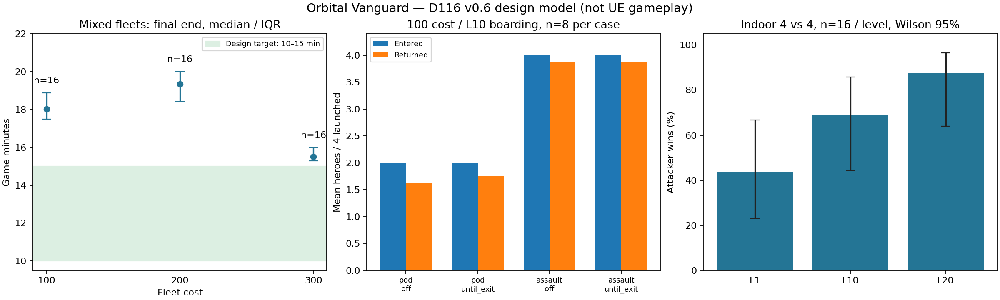

# D116 통합 전투 시험 결과 v0.6

> 평가 **1,328회 / 111조건**, 시드810000번대. Python 설계 모형이며 UE/최종 에셋 실행 결과가 아니다. [기준과 수정](../02_balance/INTEGRATED_COMBAT_BALANCE.md) · [재현](../../reference/IntegratedCombat/README.md) · [전체 원시 결과](../../reference/IntegratedCombat/results.json). 탐색 실행은 평가 표본에 합산하지 않았다.

> **후속D119:** 이 시험의 수송선 함체 입력은 이전 소형 분류다. 현행 중형 수송선의 수치/결과로 전용하지 않는다. [R37](../00_overview/OPEN_QUESTIONS.md#r37) 참조. 아래 강습선 회수 문맥의 운송 함선은 별도 소형 강습선을 뜻한다.

각 조건의 같은 시드를 짝지어 비교한다. 반복 시드는 조준/초기 위상/표적·교전 변동이며 실제 플레이어/맵 전체의 표집이 아니다. 선내전·함대전·민감도 실행 수를 합쳐 하나의 승률 표본으로 해석하지 않는다. 개발용 입력/로그의 적 편제는 상대AI나HUD에 공개되지 않는다.

**수정 후 실행 범위:** 512회 함대/연동/민감도를 새로 실행하고, 변경 영향이 없는 독립 선내전816회를 재사용했다. 재사용 전에 선내 코드/프로필·초기화 의존 함수·실행 함수가 동일함을 AST/해시로 검사했다. 수정 전1328회와 합산하지 않는다. [이전 입력/결과와 수정 근거](../../reference/IntegratedCombat/archive/README.md).

**강습선 귀환 후속 보정:** 강습선으로 진입한 인원을 포드로 귀환시키던 처리를 고쳤다. 생존 강습선으로 회수하고 강습선 상실 시 외곽15초 준비 후 구조 대기를 적용했다. 영향 있는104회를 재실행하고 나머지1224회는 입력/코드 변경 범위를 확인해 재사용했다. 각 단계의 출처/해시는 원시 결과에 보존하며 중복 합산하지 않는다.

## 일반 혼성 함대전 — 영웅 없음

| 코스트 | 표본 | 주력 교전 중앙 분 | 최종 종료 중앙 분 | 최초 완파 중앙 분 | 좌/우 승리 | 미해결 |
| --- | --- | --- | --- | --- | --- | --- |
| 100 | 16 | 16.03 | 18.02 | 0.80 | 7/9 | 0 |
| 200 | 16 | 17.65 | 19.34 | 0.67 | 10/6 | 0 |
| 300 | 16 | 15.48 | 15.50 | 0.35 | 8/8 | 0 |

주력 교전은 한쪽 잔여 코스트30% 도달이다. 최종 종료에는 추격·잔존함 처리·개별 퇴각이 포함된다.10~15분은 일반 혼성전의 목표이며 모든 압도적/특수 편성을 그 구간에 강제로 넣지 않는다.

## 모든 함종과 편성 대응

| 우측 편성 | 코스트 | 좌측 혼성 승리/표본 | 95% 구간 | 최종 중앙 분 | 미해결 |
| --- | --- | --- | --- | --- | --- |
| 전함 집중 | 100 | 0/8 | 0–32% | 7.10 | 0 |
| 미사일 집중 | 100 | 8/8 | 68–100% | 11.68 | 0 |
| 항모 집중 | 100 | 8/8 | 68–100% | 15.37 | 0 |
| 초대형 우선(100은 대형) | 100 | 0/8 | 0–32% | 7.10 | 0 |
| 채굴/수송 호위 | 100 | 3/8 | 14–69% | 18.22 | 0 |
| 방공함→순양함 | 100 | 0/8 | 0–32% | 16.56 | 0 |
| 소형 다수 | 100 | 4/4 | 51–100% | 19.96 | 0 |
| 전함 집중 | 200 | 0/8 | 0–32% | 6.31 | 0 |
| 미사일 집중 | 200 | 8/8 | 68–100% | 11.68 | 0 |
| 항모 집중 | 200 | 8/8 | 68–100% | 17.21 | 0 |
| 초대형 우선(100은 대형) | 200 | 0/8 | 0–32% | 8.91 | 0 |
| 채굴/수송 호위 | 200 | 6/8 | 41–93% | 17.55 | 0 |
| 방공함→순양함 | 200 | 0/8 | 0–32% | 16.48 | 0 |
| 소형 다수 | 200 | 4/4 | 51–100% | 20.61 | 0 |
| 전함 집중 | 300 | 0/8 | 0–32% | 6.92 | 0 |
| 미사일 집중 | 300 | 8/8 | 68–100% | 8.70 | 0 |
| 항모 집중 | 300 | 8/8 | 68–100% | 10.05 | 0 |
| 초대형 우선(100은 대형) | 300 | 1/8 | 2–47% | 12.38 | 0 |
| 채굴/수송 호위 | 300 | 3/8 | 14–69% | 15.33 | 0 |
| 방공함→순양함 | 300 | 5/8 | 31–86% | 16.50 | 0 |
| 소형 다수 | 300 | 4/4 | 51–100% | 24.11 | 0 |

함체 코스트만 같고 건조 자원/기체 구매/연구비가 같다는 뜻은 아니다. 임무 선박은 호위군 안에서 평가하며 단독 결투 승률로 채굴/수송 효용을 판정하지 않는다. 소형 다수 표본은4회로 특히 작다. PD/함재기는 거리와 공유 요격 예산을 반영한 집계 근사다. 초대형 함체·전용 주포 수치는 유지했다.

## 강습·보류 정책 — 양측 최종 편제 한도15 / L10

| 코스트 | 수송 | 사격 정책 | 영웅 진입 시행 | 목표 성공 시행 | 평균 진입 영웅 | 평균 귀환 영웅 | 목표 완파/탈출 전 | 종료 중앙 분 |
| --- | --- | --- | --- | --- | --- | --- | --- | --- |
| 100 | 개인 포드 | off | 8/8 | 3/8 | 2.00 | 1.62 | 1/8 | 18.05 |
| 100 | 개인 포드 | until_objective | 8/8 | 3/8 | 2.00 | 1.75 | 0/8 | 17.48 |
| 100 | 개인 포드 | until_exit | 8/8 | 3/8 | 2.00 | 1.75 | 0/8 | 17.98 |
| 100 | 강습선 | off | 8/8 | 6/8 | 4.00 | 3.88 | 0/8 | 17.63 |
| 100 | 강습선 | until_objective | 8/8 | 7/8 | 4.00 | 3.88 | 0/8 | 17.68 |
| 100 | 강습선 | until_exit | 8/8 | 7/8 | 4.00 | 3.88 | 0/8 | 18.70 |
| 200 | 개인 포드 | off | 2/8 | 0/8 | 0.25 | 0.25 | 0/8 | 18.87 |
| 200 | 개인 포드 | until_objective | 2/8 | 0/8 | 0.25 | 0.25 | 0/8 | 18.55 |
| 200 | 개인 포드 | until_exit | 2/8 | 0/8 | 0.25 | 0.25 | 0/8 | 18.55 |
| 200 | 강습선 | off | 8/8 | 8/8 | 4.00 | 3.50 | 0/8 | 17.31 |
| 200 | 강습선 | until_objective | 8/8 | 8/8 | 4.00 | 4.00 | 0/8 | 18.12 |
| 200 | 강습선 | until_exit | 8/8 | 8/8 | 4.00 | 3.50 | 0/8 | 18.06 |
| 300 | 개인 포드 | off | 2/8 | 0/8 | 0.25 | 0.25 | 0/8 | 15.95 |
| 300 | 개인 포드 | until_objective | 2/8 | 0/8 | 0.25 | 0.25 | 0/8 | 16.15 |
| 300 | 개인 포드 | until_exit | 2/8 | 0/8 | 0.25 | 0.25 | 0/8 | 16.15 |
| 300 | 강습선 | off | 7/8 | 4/8 | 3.50 | 1.25 | 3/8 | 16.10 |
| 300 | 강습선 | until_objective | 7/8 | 5/8 | 3.50 | 2.25 | 1/8 | 16.38 |
| 300 | 강습선 | until_exit | 7/8 | 5/8 | 3.50 | 2.00 | 0/8 | 16.32 |

계속 사격(off), 목표 달성까지 보류(until_objective), 내부 이탈까지 보류(until_exit)다. 신규 공격만 차단하며 기존탄은 유지한다. 귀환 도착과 전투 종료 시 생존은 별개다. 강습선/포드는 적의 서로 다른 무장에 노출되므로 단순 수치만으로 모든 상황의 우열을 보장하지 않는다.

| 코스트/수송·기본 보호 | 진입→목표 중앙 초(성공만) | 진입→내부 이탈 중앙 초(완료만) | 이탈 완료/진입 | 작전 영웅 전투종료 사망 |
| --- | --- | --- | --- | --- |
| 100/pod | 42.5 | 0.0 | 8/8 | 14 |
| 100/assault | 48.0 | 80.5 | 8/8 | 32 |
| 200/pod | 없음 | 0.0 | 6/6 | 2 |
| 200/assault | 51.0 | 89.0 | 8/8 | 28 |
| 300/pod | 없음 | 0.0 | 7/7 | 2 |
| 300/assault | 40.5 | 74.0 | 7/7 | 19 |

위 시간은 완료 사례에 한정한다. 실패/미완료를0초로 섞지 않는다. 목표가 살아서 끝난 경우의 생존 시간은 우측 중도절단이며 원시 `operation_timeline.observed_survival_after_entry`에 관측 하한을 남겼다. 작전 영웅 사망에는 정상 귀환 후 아군 함선 완파도 포함되므로 진입 직후 사망률로 해석하지 않는다.

## 영웅 보직 대비 강습의 교환

| 코스트 | 보직/수호15명, 강습 없음 종료 분 | 포드/이탈 보호 종료 분 | 강습선/이탈 보호 종료 분 |
| --- | --- | --- | --- |
| 100 | 17.64 | 17.98 | 18.70 |
| 200 | 18.47 | 18.55 | 18.06 |
| 300 | 15.27 | 16.15 | 16.32 |

양측 세력 예산15명·L10을 유지한다. 강습4명을 보직/수호에서 운송으로 전환하는 기회비용을 포함한다. 단순히 영웅 없는 함대와 비교해 강습만의 효과라고 주장하지 않는다. 표적/결과에 따른 전투 분기가 달라져 차이는 조건부 정책 비교다.

## 선내전 — 공격/방어 영웅 수·성장

양측 일반 병력8명, 초대형 임시 경로, 같은 레벨/장비 없는 조건. 아래는 이동을 포함한 교전 승리이며 함교 점령/함대 승리와 다르다.

| 공격 영웅 | 방어 영웅 | 레벨 | 공격 승리 | 방어 승리 | 미해결 | 중앙 초 |
| --- | --- | --- | --- | --- | --- | --- |
| 1 | 0 | 1 | 16/16 | 0/16 | 0 | 143.1 |
| 1 | 0 | 10 | 16/16 | 0/16 | 0 | 123.0 |
| 1 | 0 | 20 | 16/16 | 0/16 | 0 | 121.0 |
| 1 | 2 | 1 | 0/16 | 16/16 | 0 | 151.0 |
| 1 | 2 | 10 | 0/16 | 16/16 | 0 | 138.5 |
| 1 | 2 | 20 | 0/16 | 16/16 | 0 | 136.5 |
| 1 | 4 | 1 | 0/16 | 16/16 | 0 | 135.8 |
| 1 | 4 | 10 | 0/16 | 16/16 | 0 | 131.2 |
| 1 | 4 | 20 | 0/16 | 16/16 | 0 | 129.2 |
| 1 | 6 | 1 | 0/16 | 16/16 | 0 | 131.8 |
| 1 | 6 | 10 | 0/16 | 16/16 | 0 | 128.5 |
| 1 | 6 | 20 | 0/16 | 16/16 | 0 | 127.5 |
| 2 | 0 | 1 | 16/16 | 0/16 | 0 | 133.1 |
| 2 | 0 | 10 | 16/16 | 0/16 | 0 | 122.2 |
| 2 | 0 | 20 | 16/16 | 0/16 | 0 | 121.0 |
| 2 | 2 | 1 | 0/16 | 16/16 | 0 | 179.8 |
| 2 | 2 | 10 | 11/16 | 5/16 | 0 | 153.8 |
| 2 | 2 | 20 | 13/16 | 3/16 | 0 | 147.2 |
| 2 | 4 | 1 | 0/16 | 16/16 | 0 | 137.6 |
| 2 | 4 | 10 | 0/16 | 16/16 | 0 | 133.5 |
| 2 | 4 | 20 | 0/16 | 16/16 | 0 | 131.0 |
| 2 | 6 | 1 | 0/16 | 16/16 | 0 | 133.2 |
| 2 | 6 | 10 | 0/16 | 16/16 | 0 | 130.2 |
| 2 | 6 | 20 | 0/16 | 16/16 | 0 | 129.2 |
| 4 | 0 | 1 | 16/16 | 0/16 | 0 | 125.0 |
| 4 | 0 | 10 | 16/16 | 0/16 | 0 | 121.0 |
| 4 | 0 | 20 | 16/16 | 0/16 | 0 | 120.0 |
| 4 | 2 | 1 | 16/16 | 0/16 | 0 | 144.4 |
| 4 | 2 | 10 | 16/16 | 0/16 | 0 | 136.0 |
| 4 | 2 | 20 | 16/16 | 0/16 | 0 | 134.6 |
| 4 | 4 | 1 | 7/16 | 9/16 | 0 | 187.1 |
| 4 | 4 | 10 | 11/16 | 5/16 | 0 | 160.9 |
| 4 | 4 | 20 | 14/16 | 2/16 | 0 | 153.1 |
| 4 | 6 | 1 | 0/16 | 16/16 | 0 | 144.9 |
| 4 | 6 | 10 | 0/16 | 16/16 | 0 | 136.2 |
| 4 | 6 | 20 | 0/16 | 16/16 | 0 | 134.1 |

유형 집중/중간 레벨/장비/레벨 격차는 아래 표다. 조건명은 입력 키와 대응한다.

| 조건 | 공격 승리/표본 | 방어 승리 | 미해결 | 중앙 초 |
| --- | --- | --- | --- | --- |
| indoor_focus_melee | 0/24 | 24 | 0 | 145.5 |
| indoor_focus_ranged | 0/24 | 24 | 0 | 150.5 |
| indoor_focus_support | 11/24 | 13 | 0 | 228.0 |
| indoor_focus_commander | 0/24 | 24 | 0 | 154.8 |
| indoor_growth_L5 | 13/24 | 11 | 0 | 167.9 |
| indoor_growth_L15 | 23/24 | 1 | 0 | 151.8 |
| indoor_gear_T1 | 19/24 | 5 | 0 | 159.8 |
| indoor_gear_T4 | 23/24 | 1 | 0 | 161.4 |
| indoor_level_gap_5 | 24/24 | 0 | 0 | 147.1 |
| indoor_level_gap_20 | 0/24 | 24 | 0 | 136.5 |

## 연구·무장 조준·비대칭 임무

| 조건 | 좌측 승리 | 우측 승리 | 미해결 | 종료 중앙 분 |
| --- | --- | --- | --- | --- |
| hangar_capacity_0 | 1/8 | 6 | 1 | 28.30 |
| hangar_capacity_3 | 5/8 | 3 | 0 | 26.14 |
| fighter_research_0 | 1/8 | 6 | 1 | 28.30 |
| fighter_research_5 | 4/8 | 1 | 3 | 27.93 |
| fighter_refit | 3/8 | 2 | 3 | 26.73 |
| mission_100_vs_75 | 8/8 | 0 | 0 | 10.13 |
| mission_100_vs_125 | 0/8 | 8 | 0 | 8.28 |
| mission_100_vs_150 | 0/8 | 8 | 0 | 6.17 |
| weapon_aim | 0/8 | 0 | 8 | 30.00 |
| baseline_hull_aim | 3/8 | 5 | 0 | 17.64 |
| linked_weapon_override | 0/8 | 0 | 8 | 30.00 |
| bridge_capture | 8/8 | 0 | 0 | 15.19 |
| facility_sabotage | 7/8 | 1 | 0 | 17.89 |
| linked_growth_L1 | 5/8 | 3 | 0 | 18.15 |
| linked_growth_L20 | 6/8 | 2 | 0 | 17.75 |

연구/개조는 좌측만 적용하고 우측은 미연구/미개조 대조다. 용량 확대군은 추가 기체를 구매해 만재하므로 무료 강화 비교가 아니다. 실제 초기 기체/구매 가격은 원시 `initial_fighters` / `fighter_package_cost`에 기록한다. 임무의 적75/125/150은 개발용 조건이며 적 코스트 표시가 아니다.

## 시간 간격·실행 순서 민감도

| 조건 | 좌/우 승리 | 미해결 | 중앙 분 |
| --- | --- | --- | --- |
| deep_layout | 2/2 | 0 | 16.44 |
| dt_0.5 | 1/3 | 0 | 17.25 |
| dt_1.0 | 1/3 | 0 | 18.29 |
| dt_2.0 | 1/3 | 0 | 23.58 |
| reverse_order | 2/2 | 0 | 17.07 |

시간 간격/순서 비교는 작은 표본의 민감도 진단이다. 결과가 비슷해도 메시 충돌·수치 수렴·공정성을 인증하지 않는다. 선내전 자체는0.25초 하위 단계를 사용한다.

## 연속2회 교전 — 무상 정비/재보급 없음

| 첫 편제 | 첫 전투 승리 | 다음 전투 진입 | 다음 전투 승리 | 첫 전투 선체 복구 평균 |
| --- | --- | --- | --- | --- |
| 수리선 자리에 호위함1 | 8/8 | 8/8 | 0/8 | 0.0 |
| 수리선1 | 8/8 | 8/8 | 0/8 | 4120.3 |

별도16개 연속 시나리오(최대32교전)다. 플레이어100 대 적75의 교전 후 살아남은 실제 함선/인원/기체/체력/쿨타임/화물을 다음 적100 임무로 넘겼다. 수리/보충 없이 강행하므로 적 전력을 다시 동등하게 맞추지 않는다. 사망/포로/적함 잔류 영웅을 순간 귀환시키지 않는다. 첫 원정 전체의 최적 함대/경제나 기지 정비의 효과를 검증한 것은 아니다.

## 배치 수와 좌측 무장 명령의 보조 비교

| 조건 | 좌/우 승리 | 미해결 | 종료 중앙 분 | 좌측 영웅 사망 평균 | 목표 성공 시행 | 적 공격 무력화 시행 |
| --- | --- | --- | --- | --- | --- | --- |
| active_6 | 6/2 | 0 | 18.50 | 2.50 | 7/8 | 6/8 |
| active_10 | 7/1 | 0 | 18.97 | 7.12 | 8/8 | 7/8 |
| active_15 | 6/2 | 0 | 17.77 | 11.50 | 7/8 | 6/8 |
| left_weapon_order | 0/0 | 8 | 30.00 | 2.12 | 0/8 | 8/8 |
| left_hull_order | 4/4 | 0 | 17.91 | 13.62 | 0/8 | 4/8 |

별도40회·930000번대다. active_6/10/15는 양측 같은 배치 한도에서 강습4명을 포함한 분배다. 좌측 무장 명령은 실제 관측된 살아 있는 포탑만 고르고 없으면 해당 명령을 완료한다. 우측은 선체 공격을 유지한다. 공격 무력화는 함대 격파/승리와 별도 목표다. 명령 의도의 차이와 조준 오차를 함께 평가하며100% 무장만 맞는다고 가정하지 않는다.

## 판정과 후속 조정 우선순위

일반 혼성전의 최종 종료 중앙값은 100코스트 18.02분, 200코스트 19.34분, 300코스트 15.50분이다. **목표10~15분의 최종 밸런스에 도달했다고 판정하지 않는다.** 특히100/200의 잔존함 처리와 시설 마비/퇴각 조건을 먼저 실제UE에서 대조할 필요가 있다.

- 포드/강습선 진입 성공, 시설 목표 성공, 내부 이탈, 아군 함선 재탑승, 전투 종료 생존은 각각 다른 지표다. 강습선 귀환 경로 보정 후에도 수송선 완파·내부 전투·탈출 뒤 피격의 손실은 남을 수 있다.
- 영웅 없는 상대의 높은 강습 성공률을 일반 승률로 쓰지 않는다. L10/4영웅 공격의 방어0/2/4/6명 조건을 따로 읽는다. 유형 집중군은 양측 같은 유형이므로 그 표만으로 유형별 절대 우열을 판정하지 않는다.
- 무장 명령은 적을 살린 채 무력화할 수 있다. 격파가 아닌 무력화 임무의 성공과 일반전 종료를 분리하고, 후속 나포/철수 명령을 연결해야 한다.
-15명 분산 보직 시험은 상주 영웅의 자동 대피/최적 배치를 모두 구현한 것이 아니다. 손실률을 보고 영웅HP부터 올리거나 영구 사망을 폐기하지 않는다. 후속 실제 공간 시험에서 보직 집중/예비대·아군 함선 대피 정책을 함께 검증한다.
- 연속 원정에서 수리량이 증가해도 부족한 승무원·손실 전력·수리 화물·치료를 모두 대체하지는 못한다. 두 번째 임무의 승리 보장으로 해석하지 않는다.
-0.5/1/2초 비교의 전투 시간 차이는 수치 민감도다. 미사일/포드0.25초 사건과 PD 공유 예산·사격 주기를 실제UE의 고정 단계/이벤트 시각에서 다시 검증하기 전 작은 승률 차이를 최종 수치 근거로 쓰지 않는다.

## 적용 범위와 남은 검증

- 통합 규칙: 비활성 무지연/인원 기반 쉴드, 개별 운송과 실제 임시 방 이동/교전, 관측 기반 표적, 아군 내부 잔류 보호, 무장HP 단독 피해, 실제 점령 기반 재탈환, 유한 자원/단일 수리 작업을 적용했다.
- 실제3D 포탑 선회·메시 광선/사선·선체 롤/충각·문 폭/봉쇄, 기체 개별 궤도, 포로 확보/비상탈출 모든 경로·동시 구조 경쟁, 기지/5시간 경제는 완성된 범위가 아니다.
- 패배/미해결·강습 손실·전투시간 목표 이탈은 그대로 보고한다. 결과에 맞추어 원시 데이터를 고치거나 모든 편성을10~15분으로 강제하지 않았다.
- 실제UE/에셋 배치가 들어오면 동일 시나리오를 다시 실행한다. 현재 결과로 최종 밸런스 완료를 선언하지 않는다.
