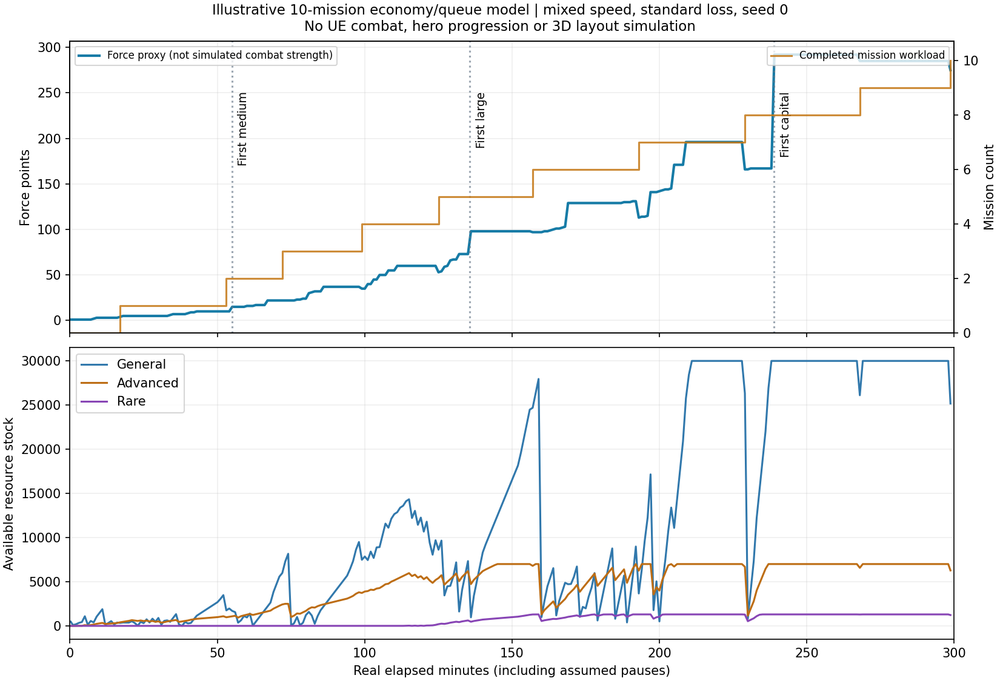

# 실제 플레이 5시간 캠페인 — 경제·진행 모형 분석

> 2026-11-16(KST). **UE 플레이 테스트/전투 시뮬레이션이 아닌 Python 경제·큐·가상 임무 작업량 모형**이다. 규칙을 확정하거나 게임 기능이 구현됐음을 뜻하지 않는다. 비용/시간 기준은 e221d23의 [밸런스v0.1](BASE_BALANCE_DRAFT.md)이며 임무·손실·배속·플레이 정책은 이번 분석을 위한 가정이다.

## 결론

**5시간 규모를 설계할 경제·기술 골격은 있지만 현 수치만으로 실제5시간을 보장할 수 없다.** 아래 가정에서6임무는 배속 활용 시 짧고,10임무는 혼합 배속/표준 손실에서5시간 경계에 도달했다. 높은 손실/1배속에는 더 길고,3배 활용에는 더 짧다. 전투 승리 가능성·영웅 재미·3D기지·퍼포먼스는 검증하지 않았다.

## 입력과 가정

- 5시간은 **실제300분**이다. 모든 생산/연구/임무 시간은 게임 분이다. 현실 시간 매60초 중12초(20%) 일시정지 가정, 나머지는 프로필별 속도로 공통 시간을 진행한다.
- 1배속 위주는 정지 외1배. 혼합은 비전투2배, 현실4분 중1분의 비전투 구간3배. 빠른 진행은 비전투3배다. 가상 임무의 교전 구간은 모두1배이며 일시정지 중 경제/작업도 정지한다.
- 시작 자원1200/0/0, 채굴선2·초계함1, 코어I·소형조선/접안/연구소/창고 각1. 채굴 순반입80/20/4의 해당 자원 하나, 광산 접근 한도는 가상 임무 완료로 증가한다. 자원 생산이 시간만 지나면 임의 단계 수입으로 뛰지 않고 실제 지불/건조한 채굴선 수로 계산된다.
- 코어 한도8/16/28/44, 건설1/2/3/4, 창고 용량·코어/연구소/조선비·기초함체/함포 티어 연구·표준함 비용/시간·병렬 슬롯을 적용한다. 기능 모듈 한도는 공사 중도 예약한다. 새 기능 모듈마다 연결1개의 비용40/시간15초를 추가한다.
- 기지 지원은 방어·레이더·아카데미·인원·물류·대형접안의 표기 비용을 포함한다. 한 개씩의 체급별 조선과 연구소2개를 사용한다. 이 배치는 예시 플레이 정책이며 최적 배치/최적 플레이 분석이 아니다.
- 균형 투자는 다음 가능한 코어/연구/설비의 자금을 군함 주문에서 유보하고 해당 체급의 첫 군함 이후 다음 코어공학에 투자한다. 함대 우선은 군함 주문 시 자금을 유보하지 않는다. 두 정책 모두 동일한 가격/기술 제약이다. 이는 게임에서 강제하는 연구 순서가 아니다.
- 임무는 **출발 시 요구 전력 점수만 검사**하고 지정 이동/교전/목표 작업 시간을 소비하면 완료 처리한다. 소형1/중형5/대형25/초대형125는 기존1:5 목표를 빌린 점수이며 실제 전투력/승패 공식이 아니다. 무장티어 연구비는 청구하지만 DPS효과는 모형화하지 않는다.
- 매임무 출발 함선 명단에 한해 독립 손실을 추첨한다. 기지에서 새로 만든 함선이 출발한 전투에 순간 합류해 손실되지 않는다. 생존 출전 함선 수리 청구는 표준가격×30%×가정 손상비율이며 다음 원정 전에 지불한다. 최종 임무 직후 미지급 수리는 결과에 별도 부채로 남긴다.
- 손실 가정10개 시드(0~9)×배속3×손실3×투자정책2×임무안2=**최종360회**. 시드 반복은 가정된 함선 손실의 민감도 분석이고,10회 중 완료 비율은 실제 게임 승률이 아니다.

| 손실 시나리오 | 출전 함선별 임무당 완파 확률 가정 | 순반입 배율 | 생존 출전함 손상 비율 |
| --- | --- | --- | --- |
| 낮음 | 5% | 100% | 10% |
| 표준 | 12% | 85% | 20% |
| 높음 | 25% | 65% | 35% |

순반입 배율은 기본 왕복 순수입에 추가적인 항로 차질을 단순 적용한 가정이다. 실제 수송선/적 습격의 이동·충돌 계산은 없다.

## 결과 — 균형 투자

| 배속 | 손실 | 6임무 완료/10회 | 6임무 완료분 중앙값 | 10임무 완료/10회 | 10임무 완료분 중앙값 |
| --- | --- | --- | --- | --- | --- |
| 1배속 위주 | 낮은 손실 | 0/10 | 5시간 내 완료 없음 | 0/10 | 5시간 내 완료 없음 |
| 1배속 위주 | 표준 손실 | 0/10 | 5시간 내 완료 없음 | 0/10 | 5시간 내 완료 없음 |
| 1배속 위주 | 높은 손실 | 0/10 | 5시간 내 완료 없음 | 0/10 | 5시간 내 완료 없음 |
| 혼합 배속 | 낮은 손실 | 10/10 | 2시간 52분 | 10/10 | 4시간 28분 |
| 혼합 배속 | 표준 손실 | 10/10 | 3시간 20분 | 8/10 | 4시간 54분 |
| 혼합 배속 | 높은 손실 | 10/10 | 4시간 03분 | 0/10 | 5시간 내 완료 없음 |
| 빠른 진행(비전투3배) | 낮은 손실 | 10/10 | 2시간 24분 | 10/10 | 3시간 53분 |
| 빠른 진행(비전투3배) | 표준 손실 | 10/10 | 2시간 45분 | 10/10 | 4시간 14분 |
| 빠른 진행(비전투3배) | 높은 손실 | 10/10 | 3시간 13분 | 2/10 | 4시간 53분 |

**중앙값은 완료한 실행만의 조건부 중앙값**이다.300분 초과 실행을300으로 바꾸거나 제외한 채 전체 완료시간으로 주장하지 않는다. 예를 들어10임무/혼합/표준은8회만 완료,2회는300분 시점9/10임무로 미완료다. 완료8회의 범위는291.50~298.75분이다.1배/표준의300분 시점 진행은6임무안4/6·10임무안6/10(각 중앙값)이다.

## 대표 경로 — 혼합/표준/균형, 미리 지정한 seed0

| 단계 | 6임무 실제 시간 | 10임무 실제 시간 |
| --- | --- | --- |
| 코어II | 0시간 17분 | 0시간 17분 |
| 첫 구축함 | 0시간 36분 | 0시간 55분 |
| 코어III | 0시간 56분 | 1시간 21분 |
| 첫 전함 | 1시간 32분 | 2시간 16분 |
| 코어IV | 2시간 05분 | 2시간 48분 |
| 첫 구축전함 | 2시간 55분 | 3시간 59분 |
| 임무안 완료 | 3시간 20분 | 4시간 59분 |

이 대표 경로는 결과를 본 뒤 고른 최적/중앙값 실행이 아니라 고정seed0이다.10임무에서는 첫 구축함이약55분으로 늦고 임무1완료~임무2완료 사이약36분이 있어 초반 콘텐츠/투자 배분 개선이 필요하다.

## 10임무 예시 구성 — 이번 분석의 새 가정

| 임무 | 내용 | 요구 전력 점수 | 이동/교전/목표 게임 분 | 대표 경로 완료 실제 시간 |
| --- | --- | --- | --- | --- |
| 1 | 초계·조작 적응 | 3 | 4/4/2 | 0시간 17분 |
| 2 | 첫 수송로 확보 | 8 | 6/6/4 | 0시간 53분 |
| 3 | 해적 보급고 습격 | 15 | 6/8/6 | 1시간 12분 |
| 4 | 희귀 자원 항로 확보 | 30 | 7/8/7 | 1시간 38분 |
| 5 | 전초기지 방어 | 50 | 6/10/6 | 2시간 04분 |
| 6 | 보급망 재개통 | 75 | 8/10/8 | 2시간 37분 |
| 7 | 국경 기지 공략 | 110 | 8/12/8 | 3시간 13분 |
| 8 | 외곽 요새 공성 | 150 | 10/12/8 | 3시간 49분 |
| 9 | 적 반격 저지 | 190 | 10/14/10 | 4시간 28분 |
| 10 | 적 본거지 공략 | 220 | 10/16/10 | 4시간 59분 |

자원지 한도는6임무안의1/2/4 완료,10임무안의2/4/6 완료에서 증가한다. 임무 수뿐 아니라 자원 접근 순서도 바뀌므로 두 결과의 차이를 ‘임무4개 시간만’으로 해석하지 않는다. 특정 희귀 자원 산지가 막힌 실제 전투를 이길 수 있는지는 이 모형으로 증명되지 않는다.

## 발견한 설계 위험과 개선 후보

1. **배속 의존:** 정상 범위에 가까운 진행도2.5~5시간 이상으로 벌어진다.5시간은 타깃 플레이 방식의 범위로 다루고 모든 배속에 같은 실제시간을 강제하지 않는다. 배속 금지로 시간을 늘리지 않는다.
2. **초반 투자 충돌:** 기본 연구/코어/중형조선/민간 확장/방어가 같은 자원을 경쟁한다.10임무의 첫 중형 약55분은 길다. 첫 중형 해금 일부를 도입 임무 보상으로 제공하거나 초기 선행 투자/기본 공정 시간을 낮추는 안을 별도로 시험할 가치가 있다. 아직 채택/재계산하지 않았다.
3. **하위 함급 대량 생산:** 함대 우선/혼합/표준6임무안은10/10회 요구조건을 끝냈지만 첫 전함 도달은9/10회,코어IV는0/10회다. 이 점수 모형은 사거리·광역·기동·장갑·시설 상성을 생략해 중형 물량을 과대평가할 수 있다. 인구 상한을 임의 추가하거나 이 결과만으로 상위함 약체를 확정하지 않는다.
4. **후반 경제 과잉:** 대표10임무 종료 누적 저장 상한 초과 반입은 일반179,549/고급61,076/최고급13,426이다. 생산한도·기술/임무 요구가 추가 지출보다 먼저 포화된다. 광산 수/고갈·민간 생산 정책·실제 손실·부가 연구·장비 개조를 추가해 재검증할 필요가 있다. 자동 자원 유지비를 지금 확정하지 않는다.
5. **기지 공간 선택의 검증 부족:** 대표10임무의 예약 기능 모듈20/코어IV44다. 이 예시는 새 추천 기능 모듈·다수 조선소·실제3D배치가 없으므로 한도44가 무조건 과도하다는 증거는 아니지만 현재 모형에서는 후기 한도가 압박하지 않는다.
6. **기존 성장 목표와 차이:** 대표6임무는 첫 중형60.9게임 분·대형144·초대형270.6으로 기존 목표20~35/55~85/110~160보다 느리다.10임무 대표는86.7/199.1/342.8게임 분이다. 목표와 실제 가격/대기열/민간·지원투자를 함께 맞춰야 하며, 이 비최적 정책 경로가 최단 도달시간은 아니다.

## 범위 밖과 다음 검증

실제 DPS·명중/회피·레이더·사선·PD·시설 파괴/유폭·영웅XP/사망/포로·강습·기지HP·3D 모듈 연결/접안·실제 수송 이동·광산 고갈·적 세력 경제·저장/불러오기는 모형에 없다. 아직 제안 단계의 신규 기능 모듈·부가 연구의 비용/효과도 적용하지 않았다. 따라서 **실제5시간 동안 재미있게 승리할 수 있다는 검증은 아니다.**

현재 근거로는10개 안팎의 임무와 자원지 확보/전초 방어를 캠페인 뼈대로 삼되, 첫 중형 도입 구간을 먼저 다듬고 실제2B전투 프로필로 대표3교전을 연결하는 것이 다음 순서다. 이후3단계 강습/영웅/복구를 넣어 경제·작업량 모형을 실제 전투 결과로 교체해야 한다. 이 분석 때문에2B 구현을 건너뛰지 않는다.

## 재현·검증

[실행 코드/입출력 안내](../reference/CampaignSimulation/README.md), [6임무 결과](../reference/CampaignSimulation/results_six.json), [10임무 결과](../reference/CampaignSimulation/results_ten.json), [대표 CSV](../reference/CampaignSimulation/trace_ten.csv), [시간 간격 민감도](../reference/CampaignSimulation/resolution_check.json)를 보존했다.

비용/시간 원문 대조·자원 보존·한도·혼합/초대형 슬롯·출격 명단·시드 재현을 검사했다. 대표seed0을 실제3초/1.5초 간격으로 비교할 때6임무 완료 차이는0.275분,10임무 차이는0.125분이었다. 이 한 경로의 수치 안정성 점검은 모든 정책/전투의 정확성 증명이 아니다.
