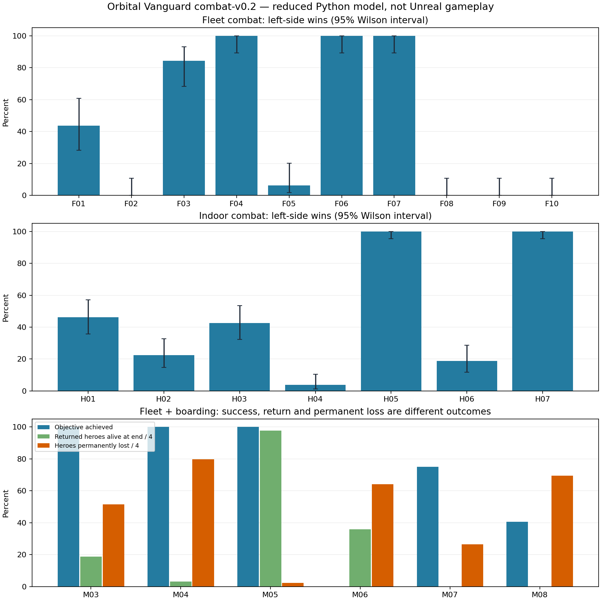

# 전투 수치v0.2 — 함대·영웅·강습 연동 모형 분석

> 1,136회 평가 시행과 해상도 비교24회. **Python 축소 모형 실행 결과이며 UE/최신 Godot Web ZIP의 플레이 결과가 아니다.** [수치표](COMBAT_BALANCE.md) · [재현 안내](../reference/CombatSimulation/README.md) · [전체 입력/원시 결과](../reference/CombatSimulation/results.json).

## 무엇을 시험했는가

- 확정 기획을 읽고 HP·장갑·무장·병사·영웅·보직·포드의 초기 후보를 설계했다. 조정 시드0~19로 첫 후보를 만들고v0.1의1000번대 평가에서 원거리 스택 우세를 확인했다. v0.2는 원거리 사거리를20→18m로 조정해 영웅/연동을 새4000번대 시드로 평가했다. 함대 입력/엔진은 그대로라1000번대320회 결과를 해시 검증 후 재사용했다. v0.2 평가 후 추가 조정하지 않았다.
- 함대10편성×32회, 선내7편성×80회, 연동8편성×32회. 평가 스텝은0.1게임초. 동형/체급 교환/PD/탐지/역할 편성/병력 수/시설 목표/사격 보류를 비교했다.
- 모든 함대가 같거나 비슷한 예산인 것은 아니다. F02~F06은 체급/수적 교환, F07/F08은 비슷한 **함체 패키지**의 방공 전환, F10과M07/M08은 방어/지원 자산 추가 시험이다. 단품 무장 가격 미산정과 추가 함선 비용을 무시하고 순수 지원 효과/공정 승률이라고 주장하지 않는다.
- 좌측 승률은 해당 편성이 전멸/소유권 판정에서 이긴 시행 비율이다. 교착/무력화/영웅 구조는 별도 결과다. 32회에서50%의95% 구간은 약34~66%로 넓다. 0/32나32/32도 실제게임의0%/100% 보장이 아니다.
- seed는 조준·초기 발사위상·제한된 진입/전투의 변동만 만든다. 실제 전장/수동 조작/진형/AI/함체 모델 다양성을 표집하지 않는다.

## 함대전 결과

| ID | 좌측 대 우측 | 좌측 승리 | 95% 구간 | 중앙 시간 s | 동시 전멸/시간초과 |
| --- | --- | --- | --- | --- | --- |
| F01 | 호위함 동형 1:1 | 14/32 (43.75%) | 28.17~60.67% | 80.55 | 0/0 |
| F02 | 호위함5 대 바스티온1 | 0/32 (0%) | 0.0~10.72% | 68.0 | 0/0 |
| F03 | 백터2 대 바스티온1 | 27/32 (84.38%) | 68.25~93.14% | 68.85 | 2/0 |
| F04 | 순양함5 대 전함1 | 32/32 (100%) | 89.28~100.0% | 95.4 | 0/0 |
| F05 | 전함3 대 구축전함1 | 2/32 (6.25%) | 1.73~20.15% | 51.8 | 0/0 |
| F06 | 전함5 대 구축전함1 | 32/32 (100%) | 89.28~100.0% | 78.75 | 0/0 |
| F07 | 미사일 순양함3 대 일반 순양함3 | 32/32 (100%) | 89.28~100.0% | 67.95 | 0/0 |
| F08 | 미사일 순양함3 대 순양함2+방공함1 | 0/32 (0%) | 0.0~10.72% | 93.3 | 0/0 |
| F09 | 자체 레이더 상실 순양함2 대 순양함2 | 0/32 (0%) | 0.0~10.72% | 360.0 | 0/32 |
| F10 | 자체 레이더 상실 순양함2+레이더함 대 순양함2 | 0/32 (0%) | 0.0~10.72% | 360.0 | 0/32 |

F07/F08의 좌측은 순양함3척의 각5문을 T2 일반미사일로 교체했다. 우측은 순양함3척 또는 순양함2+방공함1이다. 주포/미사일 공급 시설의 부위 파괴도 적용한다. F09/F10은900m 고정 교전이며 좌측 순양함의 자체 레이더를 껐다. F10만 정상 레이더함을 추가했다. 거리 경계에서 포구→목표 거리가900m를 넘으면 사거리900 함포도 발사되지 않는 엄격한 판정을 사용한다.

| 비교 | 평균 요격 격추/시행 | 평균 공격 발수/시행 |
| --- | --- | --- |
| F07 | 180.5 | 1193.219 |
| F08 | 499.219 | 1479.875 |

## 선내 영웅/일반 병력 결과

혼합4는 근거리/원거리/지원/지휘 각1명이다. 병사4명=분대1개 후보로 집계하되 전투는 인원별 사망을 처리한다. 적 지휘형1명도 동일 레벨1이다.

| ID | 좌측 대 우측 | 좌측 승리 | 95% 구간 | 중앙 시간 s | 평균 생존 영웅 |
| --- | --- | --- | --- | --- | --- |
| H01 | 혼합4 대 혼합4 | 37/80 (46.25%) | 35.75~57.1% | 33.4 | 0.84 |
| H02 | 혼합4 대 근거리4 | 18/80 (22.5%) | 14.73~32.79% | 38.6 | 0.36 |
| H03 | 혼합4 대 원거리4 | 34/80 (42.5%) | 32.26~53.43% | 29.7 | 0.62 |
| H04 | 근거리4 대 원거리4 | 3/80 (3.75%) | 1.28~10.45% | 26.1 | 0.04 |
| H05 | 혼합4 대 병사12+지휘1 | 80/80 (100%) | 95.42~100.0% | 23.2 | 2.96 |
| H06 | 혼합4 대 병사16+지휘1 | 15/80 (18.75%) | 11.71~28.66% | 29.8 | 0.21 |
| H07 | 근거리1 대 병사4 | 80/80 (100%) | 95.42~100.0% | 16.7 | 1.00 |

초기 근거리340HP/피해30/경감25%를300/25/18%로 줄이고, 원거리 사거리를14→18m, 지원 회복60/8초→85/6초(4회 제한), 지휘 오라8→12%로 조정했다. 일반 병사는55HP/피해7→65/8이다. 교정 표본의 상성은 새 평가에서 그대로 재현되지 않았다. v0.2에서도 혼합4의 승률은 근거리4 상대22.5%, 원거리4 상대42.5%로 범용 최적 편성이라 할 수 없다. 원거리4는 근거리4에 강했다. 지원/지휘의 임무 기여·실제 전열/엄폐·후퇴를 넣기 전 역할 상성이 완성됐다고 판단하지 않는다. 실제 방·문 병목·엄폐·우선 표적·사거리 단절을 넣으면 결과가 바뀔 수 있어 동일 수치를 실내 그래프에서 재시험한다.

## 함대+영웅 연동 결과

아군/적 기본 편성은 순양함1+백터1, 시작 중심거리220m로 강습 진입 후를 집중 시험한다. 적 방공함을 추가하는M07/M08은 상대가 더 비싼 편성이다. 보직은 탑승 순양함 한 척만 지원한다. 이동/접근 단계의 비용과 대규모 편대 기동은 제외한다.

영웅4명이 포드로 출격→실제 요격/쉴드 충돌→대표 경로 이동→실내 교전→점령→원 진입점 이동→포드 귀환을 연동한다. 목적지/모함 소실과 구조 대기도 기록한다. 귀환 생존의 분모는 투입 영웅4명이며 도착 후 탑승함 완파도 사망에 포함한다. 구조 대기는 사망도 생환도 아니다. 비행 중 목표 상실로 회항 처리된 일부 인원은 이 표의 세 결과에 포함되지 않으므로 합계4를 강제하지 않는다.

| ID | 정책·목표 | 함대 승리 | 시설 목표 달성 | 종료 시 귀환 생존/4 | 사망 영웅/4 | 구조 대기 영웅/4 | 시간초과 |
| --- | --- | --- | --- | --- | --- | --- | --- |
| M01 | 근접 함대전, 영웅 미운용 | 12/32 | 0.0% | 0.00 | 2.50 | 0.00 | 0 |
| M02 | 근접 함대전, 함내 지원 보직 | 14/32 | 0.0% | 0.00 | 2.25 | 0.00 | 0 |
| M03 | 쉴드실 강습, 포격 지속 | 14/32 | 100.0% | 0.75 | 2.06 | 1.19 | 0 |
| M04 | 쉴드실 강습, 잔존HP50%에서 사격 보류 | 4/32 | 100.0% | 0.12 | 3.19 | 0.69 | 0 |
| M05 | 무기실 강습, 잔존HP50%에서 사격 보류 | 32/32 | 100.0% | 3.91 | 0.09 | 0.00 | 0 |
| M06 | 함교 강습, 잔존HP50%에서 사격 보류 | 17/32 | 0.0% | 1.44 | 2.56 | 0.00 | 0 |
| M07 | 적 방공함 추가, 쉴드실 강습 | 0/32 | 75.0% | 0.00 | 1.06 | 2.94 | 0 |
| M08 | 적 방공함 추가, 함교 강습 | 0/32 | 40.6% | 0.00 | 2.78 | 1.22 | 0 |

함교 점령 직후 정지는 확정 규칙대로 적용하며 모형은 플레이어의 후속 재명령을 실행하지 않는다. 나포 함선을 바로 재투입하는 전술의 효과를 검증하지 않는다. M01/M02는 강습을 하지 않아 시설 목표/귀환 지표0이 성공/실패를 뜻하지 않는다. 원 선체 완파 시 탑승 영웅4명 사망을 포함한다. M03은 포격 지속, 나머지 강습 정책은 살아 있는 영웅이 내부에 있고 목표 선체HP가50% 아래이면 그 함선의 신규 사격을 보류하고 다른 적을 공격한다. 영웅이 포드로 이탈하면 다시 사격한다. **기발사 공격·적의 포격·코어 완파를 취소하지 않는다.**

## 결과 해석과 개선 우선순위

1. **점령과 생환의 시간 예산을 UI에 표시한다.** 이동+교전+18/36초 점령+왕복+귀환을 합치면 외부 함대전보다 길 수 있다. 적 잔존HP만 보는50% 사격 보류도 코어/유폭·기발사탄을 막지 못한다. 시설 목표 지정 시 예상 왕복시간·최소 적함 생존시간, 포격 보류/선택 표적 변경/조기 퇴각을 안내하는 개선을 권한다. 규칙 변경 없이 적용 가능한 조작 지원이며 무적 시간을 주지 않는다.
2. **쉴드실만 강습 목표로 고정하지 않는다.** 쉴드 비활성 후 지속 피격은6.5초 회복 지연을 계속 미루므로 이미 꺼진 쉴드실 점령의 추가 이익이 작을 수 있다. 무기실은 적 화력을 끊고, 함교는 소유권을 바꾸지만 시간이 길다. 엔진/레이더/공급실 등 목표를 전황과 미션 가치에 맞게 평가한다.

**영웅 손실 해석:** 선내 시험은 능동 후퇴 없는 끝까지 교전이다. 승리 편성도 전열 영웅을 잃을 수 있다. 영구 사망 게임에서 이 손실을 매 임무 정상 비용으로 쓰면5시간 캠페인이 쉽게 붕괴한다. HP30% 등 사전 퇴각 조건·이탈 경로 확보·분대 엄호·목표 우회/조기 추출을 넣고 임무별 생환률을 다시 측정해야 한다. 모델의 사망률을 플레이어의 실제 손실 확률로 확정하지 않는다.

3. **레이더 상실 AI의 접근/퇴각과 교착을 처리한다.** 탐지 없는 장거리 발사 금지는 유지한다. 보장 근거리로 접근하거나 실제 아군 정보를 쓰고, 쏠 수 없는 이유를 HUD에 보여준다. 양측 엔진/무장이 정지한 상황을 전멸까지 무한 대기시키지 말고 무력화 목표·수리/나포·퇴각 선택의 승리 조건을 별도 설계한다.
4. **체급은 직선 배율로 맞추지 않는다.** 소형 다수는 동시 사선·집중 피해·시설 타격 수가 많고, 큰 함체는 피탄 면적이 커진다. 반대로 대형 장갑/PD는 하위 공격을 막는다. 제한된1:5 시험을 모든 함종/가격에 보장하지 않으며 측면 공격·수리·함재기·전문 역할을 넣어 교환비를 다시 측정한다.
5. **PD는 표면 장착점·접촉 시간·중복 사격을 검증한다.** 선체 중심에서111m를 재면 초대형함 외벽 밖으로 나가지 못할 수 있다. 여러 PD가 이미 죽은 미사일에 중복 발사하거나, 목표가 바뀌어 적대 판정만 갱신돼 기발사탄이 소멸하는 오류를 막는다. 다수 발사체의 표적 배정/예약과 대형 함체 표면 배치를 실측한다.

**쉴드 지연 비교:** 아래 별도 민감도 시험처럼 피격마다 지연을 초기화하면 “전투 중 비활성 회복”이 거의 발동하지 않을 수 있다. 파괴 시 한 번 지연하는 대안은 쉴드실 강습의 가치도 높인다. 두 정책 중 채택은R11에 명시하고 같은 연동 편성을 재시험한다.

6. **유폭은 별도 피해 예산으로 다시 설계한다.** 임시 `20×관련 무장 티어합`은 큰 함선에서 약하다. 반대로 인접6개 시설에 각각 선체 비율 피해를 주고 전부 선체HP로 전달하면 한 번 폭발이6배 증폭된다. 권장 후속안은 공급 용량에 따른 인접 시설 피해와 사건당 선체 전달 상한을 분리하고, 시설 ID별1회 폭발·체급별 인접 코어·연쇄 배치 시나리오로 재산정하는 것이다. 해당 수치는 이번 시험으로 확정하지 않는다.
7. **회복/비용 악용을 제한한다.** 회복은 생존자에게만, 작전당 유한 횟수/실제 자원 소모를 둔다. 순양함용 고정 비용으로 초대형의 같은 비율을 수리하게 확장하지 않는다. 동일 지휘/보직 효과는 최고값 우선으로 중첩 폭주를 막는다. 다만 다른 영웅/시설 효과의 중첩 규칙 전체는 추가 시험이 필요하다.
8. **부위 피해와 승무원을 추가한 뒤 다시 맞춘다.** 현재 선내 경비는 대표 경로에 집중한 가정이다. 필수 시설 경비가 실제 이동하는 그래프, 승무원 효율·중복 시설·생명유지/재난·외장 무장 저격·무장 교체 비용이 들어오면 HP만으로 산정한 가치가 바뀐다.

**연동 결과의 경계:** 무기실 점령 효과는 수비 측이 수리/재탈환하지 않는 가정에서 측정했다. 함교 강습은 공통 대표 배치의 전면 함교가 포격에 먼저 물리 파괴되면 목표를 취소한다. 이는 후방 함교·다른 내부 배치·사격 부위 지정을 시험한 결과가 아니다. 나포 직후 재명령·재탈환·시설 복구를 넣어야 강습의 최종 이득을 판단할 수 있다.

## 수치 해상도와 재현 검사

| 사례 | 비교 시드 | 0.1초 / 0.05초 승자 | 시간 s(0.1 / 0.05) |
| --- | --- | --- | --- |
| F01 | 2000 | 0 / 0 | 81.4 / 81.4 |
| F01 | 2001 | 1 / 1 | 79.8 / 79.75 |
| F01 | 2002 | 0 / 1 | 83.7 / 83.4 |
| F03 | 2000 | 0 / 0 | 67.8 / 67.75 |
| F03 | 2001 | 0 / 0 | 68.1 / 69.75 |
| F03 | 2002 | 0 / 0 | 69.3 / 68.95 |
| H02 | 5000 | -1 / 1 | 49.7 / 44.75 |
| H02 | 5001 | 1 / 1 | 34.7 / 40.75 |
| H02 | 5002 | 1 / 1 | 40.7 / 29.75 |
| M06 | 5000 | 1 / 1 | 64.7 / 63.55 |
| M06 | 5001 | 0 / 0 | 64.5 / 64.2 |
| M06 | 5002 | 0 / 1 | 66.8 / 66.8 |

함대 시드2000~2002·영웅/연동5000~5002에서4편성×두 스텝을 비교했다. 승자 변경은12쌍 중3쌍이다. 확률 소비 순서·발사 시간·AI 경로가 달라질 수 있어 개별 시행의 일치를 보장하지 않는다. 이12쌍은 전체 편성의 수치 수렴 증명이 아니며, 게임에서는 고정 시뮬레이션 스텝/분리 RNG와0.22초 살보의 사건 시간 처리를 검증한다.

모형 규칙 검사22개 통과: 활성 쉴드 회복 금지/비활성 지연·50% 재가동, 코어 완파, 선체1회 피해, 빈 슬롯/초과분, 공급과PD 독립, 최선 레이더/발사 차단, 나포 전 발사탄 유지, 비유도 경로, 표면PD, 유폭1회·3층 관통, 파괴 함교 점령 금지, 유한 회복·사망 비복원·오라 중첩·영웅 중복 사망 방지·귀환 후 탑승함 완파 사망·탈출 후 사격 보류 해제·쉴드 포드 충돌. **UE 자동/API 검사 수에 합산하지 않는다.**

## 쉴드 지연 갱신의 별도 민감도 시험

[재현 코드](../reference/CombatSimulation/shield_delay_experiment.py)와 [원시 결과](../reference/CombatSimulation/shield_delay_results.json): 호위함1:1, 별도 시드3000~3007, 각8회(총16회), 다른 조건은 동일하다. 피격마다6.5초 지연을 초기화한 기준은 전투 중앙81.05초·평균 쉴드 재가동0회, 파괴 시 한 번만 지연한 대안은99.95초·4.125회였다. 이는 별도8쌍의 국소 비교이며 전체 연동 모형의 재검증/대안 채택은 아니다. **의도한 전투 중 회복을 살리려면 파괴 시 한 번 지연하는 쪽을 추천**하되 최종 정책과2B 시험에 반영할 때 수치 버전을 올린다. 공식v0.2 결과를 대안 결과로 소급 해석하지 않는다.

## 이번 모형이 포함하지 않는 것

- 실제 FBX/PBR/터렛 계층·함체 충돌/충각/정밀 사선 재배치·수동 자세/롤·복잡 진형. 함선 충돌은 타원체, 레이더 근거리는 길이 근사다. 발사 후 아군의 우발 충돌은R21을 대신 결정하지 않고 제외했다.
- 모든 시설의 완전한 상태 전이: 1/2층 연동 장갑, 시설 중복/운영 인원·생명유지 사망·재난·외부 포격의 영웅 직접 피해. 시설 배치는 계열별 미장착 공급실까지 둔 공통 대표 템플릿이라 실제 설계 슬롯의 효율 최적화를 검증하지 않는다. 함교HP1.8배는 반영하나 실제 선내 장갑/선원/재탈환 전체는 아니다.
- 실제 방/문/복도 경로와 전열·관통/엄폐/우선 표적, 구조 인양 완료/포로·재탈환·공작 체크포인트·강습선·영웅 성장/장비/난이도. 포드 비행 중 목표 상실의 회항은 단순 결과 처리이며 전체 귀환 경로/대체 목적지 변경을 재현하지 않는다.
- 항모/함재기 경쟁 요격·명시 귀환/수리·모함 관제, 수리함의 시설/장갑 복구,FTL. JSON에 들어 있는 이 분야 값은 미시험 제안이다.
- 무장 단품 가격·공급/유지비·영웅 획득/보충·성계 이동·전략AI와5시간 실제 캠페인. 이전 경제 모형 결과를 이번 전투 결과로 소급 갱신하지 않았다.

## 수치 조정 이력

[v0.1 프로필](../reference/CombatSimulation/archive/profile_v01.json)과 [v0.1 결과](../reference/CombatSimulation/archive/results_v01.json)를 고정 보관했다. v0.2는 원거리 사거리18m를 쓰며, 귀환한 영웅도 도킹한 함선이 나중에 완파되면 사망하도록 집계를 보완했다. 결과의reuse_provenance는 함대/영웅 소스 구성요소 해시 일치 및 함대가 사용하는global/ships/weapons/radar/tier_damage/officers 입력의 동일성을 확인한320회 재사용 근거다. 후속 보완은 귀환 후 탑승함 완파 시 사망과 영웅 이탈 후 사격 보류 해제를 포함한다. 평가 시드와 신구 결과를 합산해 표본수를 부풀리지 않았다.

## 제작 판단

이 프로필로2B의 외부전 데이터를 시작할 수 있다. 확정된 게임 판정은 담당 명세를 따르고, 신규 수치를 교체 가능한 데이터로 옮긴다.2B→2C→3단계마다 같은 편성·전황 로그/피해 원인·목표 달성/생환을 수집해 재조정한다. 지금 단계에서 전체 전투 밸런스가 완성됐다고 선언하지 않는다.
